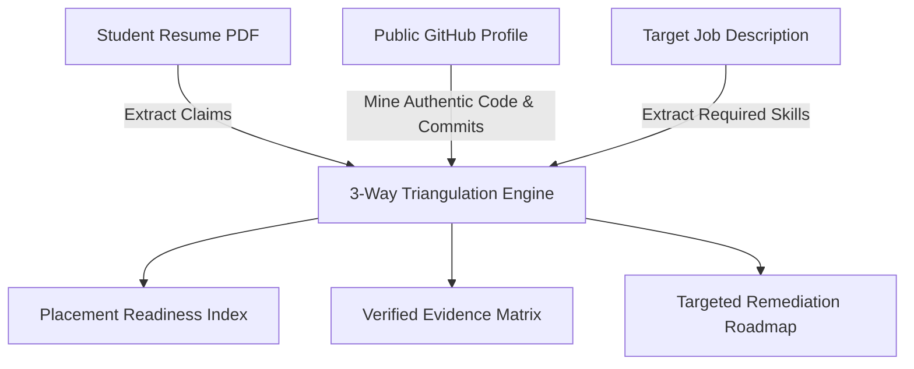
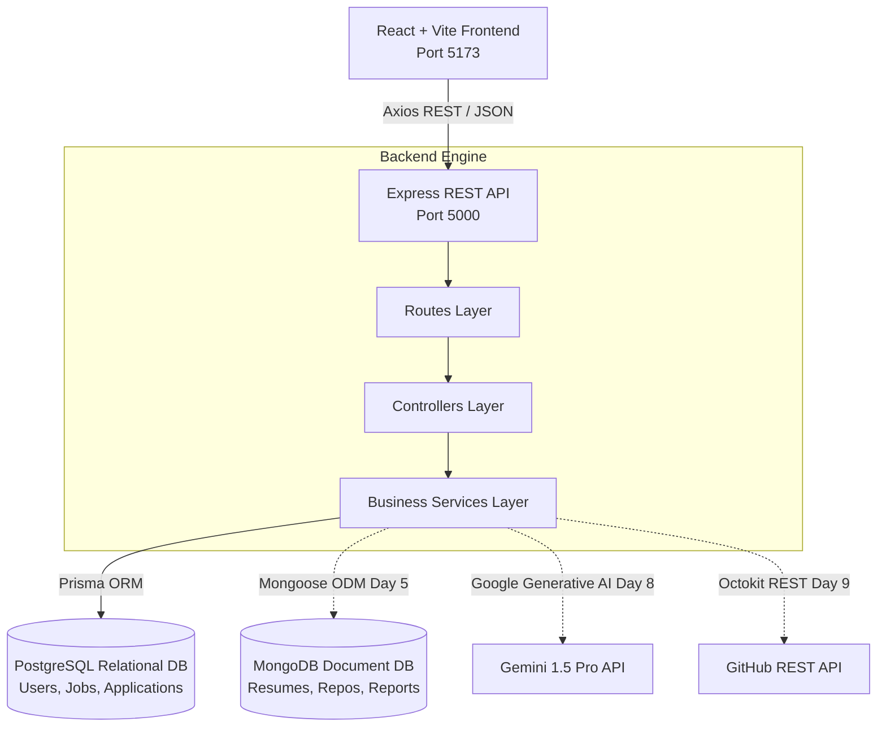
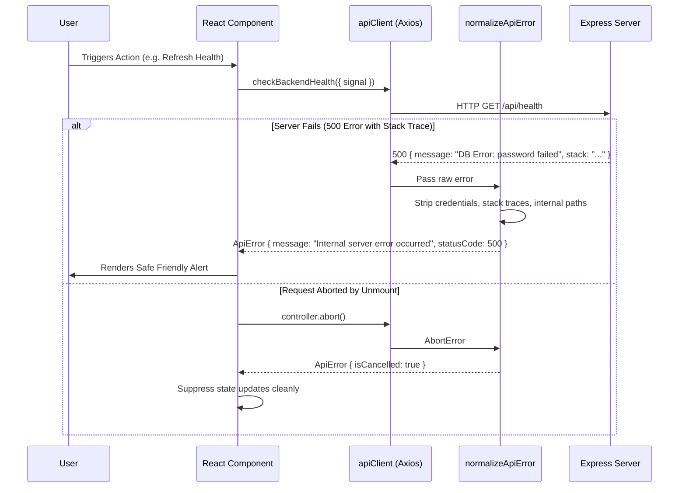

# Tekmira AI — Complete Master Architecture & Development Notes
**Project:** Tekmira AI  
**Tagline:** Beyond Claims. Driven by Evidence.  
**Scope:** Chronological Master Walkthrough (Day 1 through Day 4) + Architectural Deep Dive & Viva Defense

---

## Table of Contents
1. [Executive Summary & Problem Statement](#1-executive-summary--problem-statement)
2. [The Rebranding & Core Identity](#2-the-rebranding--core-identity)
3. [Day 1: Project Scaffolding, Architecture & Documentation Baseline](#3-day-1-project-scaffolding-architecture--documentation-baseline)
4. [Day 2: Frontend Design System, Shell & Navigation](#4-day-2-frontend-design-system-shell--navigation)
5. [Day 3: JavaScript Core Foundations, Safe API Client & Error Handling](#5-day-3-javascript-core-foundations-safe-api-client--error-handling)
6. [Day 4: PostgreSQL Relational Database, Prisma ORM & SQL JOINs](#6-day-4-postgresql-relational-database-prisma-orm--sql-joins)
7. [Day 5 Roadmap: MongoDB Document Modeling & Polyglot Persistence](#7-day-5-roadmap-mongodb-document-modeling--polyglot-persistence)
8. [Comprehensive System Architecture & Data Flow Diagrams](#8-comprehensive-system-architecture--data-flow-diagrams)
9. [Master Viva Voce & Technical Defense Cheat Sheet](#9-master-viva-voce--technical-defense-cheat-sheet)

---

## 1. Executive Summary & Problem Statement

### 1.1 The Campus Placement Problem
In technical campus placements, college graduates submit resumes claiming proficiencies in advanced frameworks, distributed databases, and high-concurrency architectures (e.g. Docker, Redis, Kubernetes, React, GraphQL). However, recruiters encounter massive **resume inflation**:
- Candidates memorize buzzwords without writing real code.
- Traditional resume screening tools (ATS) only match keywords, penalizing genuine coders whose resumes lack marketing buzzwords.
- Students receive zero actionable, objective feedback on whether their real code matches hiring standards.

### 1.2 The Tekmira AI Solution: 3-Way Triangulation
Tekmira AI solves this by cross-verifying three independent sources of truth:
1. **Claimed Skills (Input):** Extracted from student resume PDFs via natural language parsing.
2. **Empirical Evidence (Proof):** Mined directly from the student's public GitHub repositories (authentic commits, AST language distribution, lines of code, test files).
3. **Objective Benchmarks (Standard):** Ingested from real campus job descriptions (JDs).



---

## 2. The Rebranding & Core Identity

- **Previous Temporary Name:** SkillProof AI
- **Official Identity:** **Tekmira AI**
- **Tagline:** *Beyond Claims. Driven by Evidence.*
- **Workspace Status:** 100% rebranded. Zero occurrences of the old name remain across all frontend components, backend controllers, configuration files, package manifests, and documentation.
- **Color System:**
  - Primary Navy: `#10223D` (Authoritative, structured)
  - Surface Navy: `#203753` (Sidebar, elevated cards)
  - Canvas White: `#FFFFFF` and `#F7F9FC` (~90% of surfaces)
  - Restrained Coral Accent: `#FF806F` (~10% for focal actions and highlights)
  - Typography: `#172033` (High-contrast text), `#64748B` (Muted captions)

---

## 3. Day 1: Project Scaffolding, Architecture & Documentation Baseline

### 3.1 Initial Setup & Scaffolding
- **Client:** React 18, Vite 6, Tailwind CSS 3, React Router v6.
- **Server:** Node.js (v22), Express 4 (pure ES Modules with `"type": "module"`).
- **Decoupled Architecture:** Client and Server are completely separated.
  - Client compiles into static assets deployable to edge CDNs.
  - Server operates as a stateless RESTful API engine.

### 3.2 The Critical `app.js` vs `server.js` Separation
One of the most important architectural patterns implemented on Day 1 was decoupling application configuration from process execution:
- **`server/src/app.js`:** Configures Express, CORS, JSON body parsers, routes, and centralized error handling middleware. It exports `app` without calling `.listen()`. This enables in-memory automated testing (Supertest) without port collisions.
- **`server/src/server.js`:** The process entry point. It imports `app.js`, binds to `PORT=5000`, and attaches operating system signal listeners (`SIGTERM`, `SIGINT`) for graceful shutdown.

### 3.3 Documentation Baseline Created
On Day 1, five living architectural specifications were created:
1. `PROJECT_RULES.md`: 12 Master Development Rules, zero-secrets policy, and academic 7-Question framework.
2. `docs/PRD.md`: Problem definition, user personas (Student, Recruiter, Placement Cell), functional and non-functional requirements.
3. `docs/HLD.md`: System topology, polyglot persistence architecture, network boundaries, and security design.
4. `docs/LLD.md`: Folder structures, component contracts, API endpoint catalogs, and data models.
5. `docs/VIVA_PREP.md`: Living academic question bank for viva voce and project defense.

### 3.4 Git Repository Initialization
- Local Git initialized on branch `main` at `c:\Users\phani\OneDrive\Desktop\Tekmira AI`.
- Connected to remote repository: `https://github.com/phanindra199/Tekmira-AI.git`.
- Pushed initial commit: `b3ff54d chore: initialize Tekmira AI foundation`.

---

## 4. Day 2: Frontend Design System, Shell & Navigation

### 4.1 Resolution of Initial UI Scaffolding Cards
During early testing, the dashboard temporarily showed cards labeled *"Architecture Readiness Check"*, *"Viva Preparation Tip"*, and *"System Pipeline"*. 
- **Cause:** These were Day 1 development placeholders used to test routing and verify that the Express health endpoint was reachable.
- **Resolution in Day 2:** These placeholders were completely replaced with a student-facing placement portal, and technical notes were relocated to [LLD.md](file:///docs/LLD.md) and [VIVA_PREP.md](file:///docs/VIVA_PREP.md).

### 4.2 Reusable Atomic UI Library (`client/src/components/common/`)
To ensure visual consistency and accessibility, an 8-piece design system was implemented:
- `Button.jsx`: Variants (`primary`, `secondary`, `outline`, `ghost`, `coral`), loading state, disabled states, accessible focus ring.
- `Card.jsx`: Compound component (`Card`, `CardHeader`, `CardTitle`, `CardDescription`, `CardContent`, `CardFooter`).
- `Input.jsx`: Controlled form input with label association, helper text, error text, and left/right icon slots.
- `Badge.jsx`: Semantic status indicators (`neutral`, `success`, `warning`, `coral`, `navy`).
- `PageHeader.jsx`: Title, subtitle, and action button slots.
- `LoadingIndicator.jsx`: ARIA-compliant loading spinner.
- `ErrorMessage.jsx`: Alert container with retry button callback.
- `EmptyState.jsx`: Zero-data state guiding candidates to connect GitHub or upload a resume.

### 4.3 Shell & Navigation Architecture
- **`MainLayout.jsx`:** Master application shell coordinating the top Navbar, collapsible mobile Sidebar drawer, and Footer.
- **`Sidebar.jsx`:** Persistent navigation with 8 routes:
  1. Overview (`/dashboard`)
  2. Resume Analysis (`/resume-analysis`)
  3. GitHub Analysis (`/github-analysis`)
  4. Job Matching (`/job-match`)
  5. Skill Evidence (`/skill-evidence`)
  6. Interview Preparation (`/interview-prep`)
  7. Verification Reports (`/analysis-report`)
  8. Candidate Settings (`/settings`)
- **`Navbar.jsx`:** Top brand navigation with live backend connectivity badge and candidate profile menu dropdown.

### 4.4 Day 2 Verification & Commit
- Production build verified: 1,668 modules compiled in 7.62s with 0 errors.
- Committed locally: `e2e83e7 feat(day-2): frontend design system, application shell, and navigation`.

---

## 5. Day 3: JavaScript Core Foundations, Safe API Client & Error Handling

### 5.1 JavaScript Foundations Documented in Viva Prep
Detailed explanations, code snippets, Tekmira AI use cases, viva questions, and practice exercises were documented for:
1. **Hoisting:** Difference between `var` (initialized to `undefined`) and `let`/`const` (Temporal Dead Zone).
2. **Closures:** Lexical scoping, private variables, and practical use in debounced search and token management.
3. **Event Loop:** Call Stack $\to$ Web APIs $\to$ Microtask Queue (Promises, `async/await`) $\to$ Macrotask Queue (`setTimeout`, I/O).
4. **Promises vs Callbacks:** Inversion of control, callback hell, Promise states (`pending`, `fulfilled`, `rejected`).
5. **Async/Await & Concurrency:** Synchronous syntax over Promises, `Promise.all` for parallel operations vs `Promise.allSettled`.

### 5.2 Centralized Axios Client (`client/src/services/apiClient.js`)
- Configured with `import.meta.env.VITE_API_BASE_URL || 'http://localhost:5000/api'`.
- 15-second request timeout to prevent hanging connections.
- Automatic JSON unwrapping via response interceptors.
- Slot for JWT Bearer token injection.

### 5.3 Sanitized Error Normalization (`client/src/utils/apiError.js`)
Enforces enterprise security standards by categorizing errors into structured types without leaking internal server information:
- **`NETWORK_ERROR`:** Handles server offline, DNS failures, or CORS blocks with user-friendly guidance.
- **`TIMEOUT_ERROR`:** Informs user when the server took too long to respond.
- **`VALIDATION_ERROR` (400):** Extracts field-level validation errors.
- **`UNAUTHORIZED` (401):** Prompts candidate to sign in.
- **`FORBIDDEN` (403):** Access denied.
- **`NOT_FOUND` (404):** Resource missing.
- **`SERVER_ERROR` (500):** **Critical security protection:** Replaces database connection strings, passwords, or stack traces with: *"An internal server error occurred. Our engineering team has been notified."*
- **`REQUEST_CANCELLED`:** Handled cleanly when an `AbortController` terminates an in-flight request.

### 5.4 Lifecycle Unmount Safety (`AbortController`)
In both `BackendStatusBadge.jsx` and `DashboardPage.jsx`:
- An `AbortController` cancels pending HTTP requests when components unmount or when the user triggers rapid retries.
- Prevents memory leaks and the React warning: *"Can't perform a React state update on an unmounted component"*.

### 5.5 Day 3 Testing & Commit
- Automated test suite `client/src/utils/testErrorMapping.js` executed: **16 passed, 0 failed**.
- Production build verified: 1,669 modules compiled in 8.85s with 0 errors.
- Committed locally: `71f7c73 feat(day-3): javascript foundations, reusable api client, and safe error normalization`.
- Pushed both Day 2 and Day 3 commits to GitHub remote (`origin/main`).

---

## 6. Day 4: PostgreSQL Relational Database, Prisma ORM & SQL JOINs

### 6.1 Polyglot Persistence Architecture
Tekmira AI separates structured relational data from semi-structured document data:
- **PostgreSQL (Relational):** Strict ACID transactions, foreign key constraints, relational queries (Users, Job Descriptions, Saved Jobs, Job Applications).
- **MongoDB (Document-Oriented - Day 5):** Polymorphic AST trees, raw resume texts, repository commit trees, and full AI report JSON payloads.

### 6.2 Prisma Relational Schema (`server/prisma/schema.prisma`)
```prisma
model User {
  id           String           @id @default(uuid())
  email        String           @unique
  passwordHash String
  fullName     String
  githubHandle String?
  collegeName  String?
  graduationYr Int?
  role         Role             @default(STUDENT)
  createdAt    DateTime         @default(now())
  updatedAt    DateTime         @updatedAt

  savedJobs    SavedJob[]
  applications JobApplication[]

  @@map("users")
}

model JobDescription {
  id             String           @id @default(uuid())
  title          String
  company        String
  location       String?
  jobType        String?
  rawText        String           @db.Text
  requiredSkills String[]
  minExperience  Int              @default(0)
  createdAt      DateTime         @default(now())
  updatedAt      DateTime         @updatedAt

  savedBy        SavedJob[]
  applications   JobApplication[]

  @@map("job_descriptions")
}

model SavedJob {
  id        String         @id @default(uuid())
  userId    String
  jobId     String
  savedAt   DateTime       @default(now())

  user      User           @relation(fields: [userId], references: [id], onDelete: Cascade)
  job       JobDescription @relation(fields: [jobId], references: [id], onDelete: Cascade)

  @@unique([userId, jobId])
  @@map("saved_jobs")
}

model JobApplication {
  id          String            @id @default(uuid())
  userId      String
  jobId       String
  status      ApplicationStatus @default(SAVED)
  matchScore  Float?
  notes       String?           @db.Text
  appliedAt   DateTime?
  createdAt   DateTime          @default(now())
  updatedAt   DateTime          @updatedAt

  user        User              @relation(fields: [userId], references: [id], onDelete: Cascade)
  job         JobDescription    @relation(fields: [jobId], references: [id], onDelete: Cascade)

  @@map("job_applications")
}
```

### 6.3 Database Service Layer & SQL JOIN Equivalents
Created [`server/src/services/jobApplicationService.js`](file:///server/src/services/jobApplicationService.js) demonstrating:
1. **Candidate Applications (`INNER JOIN`):**
   ```sql
   SELECT u.fullName, u.githubHandle, j.title, j.company, a.status, a.matchScore
   FROM users u
   INNER JOIN job_applications a ON u.id = a.userId
   INNER JOIN job_descriptions j ON a.jobId = j.id;
   ```
2. **Inactive Candidates (`LEFT JOIN ... WHERE IS NULL`):**
   ```sql
   SELECT u.fullName, u.email
   FROM users u
   LEFT JOIN job_applications a ON u.id = a.userId
   WHERE a.id IS NULL;
   ```
3. **Campus Placement Aggregation (`GROUP BY`):**
   ```sql
   SELECT j.title, j.company, ROUND(AVG(a.matchScore)::numeric, 2) AS avgMatch
   FROM job_descriptions j
   INNER JOIN job_applications a ON j.id = a.jobId
   GROUP BY j.id, j.title, j.company;
   ```

### 6.4 Safe Database Connection & Health Check
- Created [`server/src/config/database.js`](file:///server/src/config/database.js) with `checkDatabaseHealth()` executing a lightweight `SELECT 1` ping.
- Integrated into `/api/health?detailed=true`. If PostgreSQL is offline, the backend remains operational and gracefully reports `{ status: "disconnected" }` without crashing or exposing passwords.

### 6.5 Day 4 Testing & Local Commit
- Executed `server/src/database/testRelationalQueries.js`: **8 passed, 0 failed**.
- Committed locally: `4e256f1 feat(day-4): postgresql relational models, prisma orm, and sql join service layer`.

---

## 7. Day 5 Roadmap: MongoDB Document Modeling & Polyglot Persistence

The next sequential phase is **Day 5 (MongoDB Document Database Foundation)**:
1. **`ResumeDocument` Schema:** Stores parsed candidate resume text and extracted claims.
2. **`RepositorySnapshot` Schema:** Stores public GitHub commit metadata, lines of code, and language distributions.
3. **`SkillAnalysisReport` Schema:** Stores complete Gemini 3-way triangulation results, verified commit links, and remediation roadmaps.
4. **Mongoose Connection Module:** Safe URI management and resilient reconnection handling.
5. **CRUD Services:** Create, Read, Update, and Delete operations for analysis records.

---

## 8. Comprehensive System Architecture & Data Flow Diagrams

### 8.1 High-Level Component Topology


### 8.2 Client-Side API Error Sanitization Flow


---

## 9. Master Viva Voce & Technical Defense Cheat Sheet

| Question | Examiner's Focus | Key Technical Answer |
| :--- | :--- | :--- |
| **Why not just send the resume to Gemini/ChatGPT?** | Architecture & Hallucination Prevention | LLMs analyzing only a resume evaluate *claims*, not *proof*. This causes hallucination and rewards buzzword inflation. Tekmira AI grounds evaluation by triangulating resume claims against empirical GitHub commit evidence and target job requirements. |
| **Why separate `app.js` and `server.js`?** | Separation of Concerns & Testing | `app.js` configures middleware and routes without binding to a network port, enabling in-memory Supertest integration testing. `server.js` handles port listening, process signals (`SIGTERM`), and database lifecycles. |
| **Why use UUIDs instead of auto-increment IDs in PostgreSQL?** | Database Security | Auto-incrementing integers (`1, 2, 3...`) are vulnerable to sequential enumeration attacks. UUIDv4 is 128-bit globally unique and non-guessable. |
| **Why use both PostgreSQL and MongoDB (Polyglot Persistence)?** | Data Modeling Fundamentals | Relational data with strict foreign keys and ACID constraints belongs in PostgreSQL (Users, Job Postings, Applications). Polymorphic, deeply nested trees (resume ASTs, commit trees, and AI reports) belong in MongoDB. |
| **What happens in the Event Loop when an Axios request resolves?** | JavaScript Runtime Knowledge | The HTTP request runs in browser background threads. When it completes, its Promise resolution callback enters the **Microtask Queue**, which the Event Loop prioritizes immediately after the Call Stack empties and *before* any Macrotask (`setTimeout`). |
| **How does Prisma prevent SQL Injection?** | Web Application Security | Prisma utilizes **parameterized queries** (`$1`, `$2`), treating all user inputs as literal data rather than executable SQL syntax. |
| **What is `AbortController` and why is it used?** | React Performance & Memory Hygiene | It cancels in-flight HTTP requests when a React component unmounts or when a newer request supersedes an older one, preventing memory leaks and state updates on unmounted DOM trees. |
