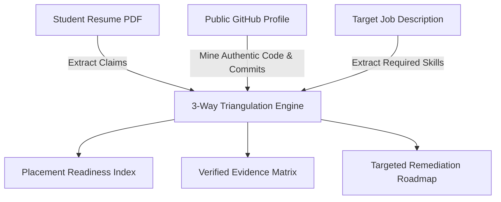
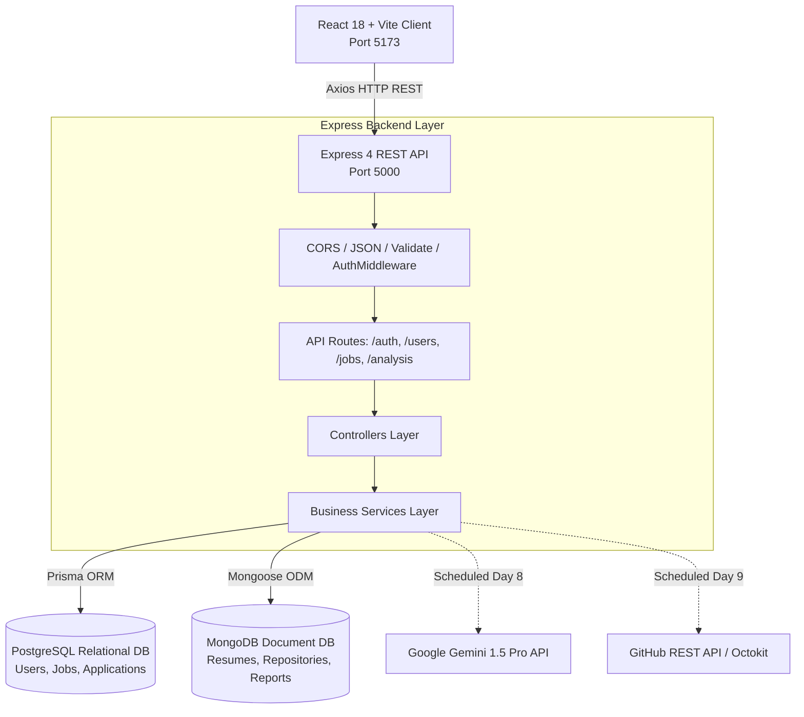

# Tekmira AI — Complete Master Architecture & Development Notes
**Project:** Tekmira AI  
**Tagline:** Beyond Claims. Driven by Evidence.  
**Scope:** Chronological Master Walkthrough (Week 1: Days 1 through 7 Completed) + Architectural Deep Dive & Viva Defense

---

## Table of Contents
1. [Executive Summary & Problem Statement](#1-executive-summary--problem-statement)
2. [The Rebranding & Core Identity](#2-the-rebranding--core-identity)
3. [Day 1: Project Scaffolding, Architecture & Documentation Baseline](#3-day-1-project-scaffolding-architecture--documentation-baseline)
4. [Day 2: Frontend Design System, Shell & Navigation](#4-day-2-frontend-design-system-shell--navigation)
5. [Day 3: JavaScript Core Foundations, Safe API Client & Error Handling](#5-day-3-javascript-core-foundations-safe-api-client--error-handling)
6. [Day 4: PostgreSQL Relational Database, Prisma ORM & SQL JOINs](#6-day-4-postgresql-relational-database-prisma-orm--sql-joins)
7. [Day 5: MongoDB Document Database Foundation & Mongoose Schemas](#7-day-5-mongodb-document-database-foundation--mongoose-schemas)
8. [Day 6: Authentication & Middleware Foundation (Bcrypt + JWT)](#8-day-6-authentication--middleware-foundation-bcrypt--jwt)
9. [Day 7: REST API Architecture, Zod Validation & Full-Stack Integration](#9-day-7-rest-api-architecture-zod-validation--full-stack-integration)
10. [Week 2 Roadmap Preview (Days 8–14)](#10-week-2-roadmap-preview-days-814)
11. [Comprehensive System Architecture & Data Flow Diagrams](#11-comprehensive-system-architecture--data-flow-diagrams)
12. [Master Viva Voce & Technical Defense Cheat Sheet](#12-master-viva-voce--technical-defense-cheat-sheet)

---

## 1. Executive Summary & Problem Statement

### 1.1 The Campus Placement Problem
In technical campus placements, college graduates submit resumes claiming proficiencies in advanced frameworks, distributed databases, and high-concurrency architectures (e.g. Docker, Redis, Kubernetes, React, GraphQL). However, recruiters encounter massive **resume inflation**:
- Candidates memorize buzzwords without writing real code.
- Traditional resume screening tools (ATS) only match keywords, penalizing genuine coders whose resumes lack marketing buzzwords.
- Students receive zero actionable, objective feedback on whether their real code matches hiring standards.

### 1.2 The Tekmira AI Solution: 3-Way Triangulation
Tekmira AI solves this by cross-verifying three independent sources of truth:
1. **Claimed Skills (Input):** Extracted from student resume PDFs via natural language parsing.
2. **Empirical Evidence (Proof):** Mined directly from the student's public GitHub repositories (authentic commits, AST language distribution, lines of code, test files).
3. **Objective Benchmarks (Standard):** Ingested from real campus job descriptions (JDs).



---

## 2. The Rebranding & Core Identity

- **Previous Temporary Name:** SkillProof AI
- **Official Identity:** **Tekmira AI**
- **Tagline:** *Beyond Claims. Driven by Evidence.*
- **Workspace Status:** 100% rebranded. Zero occurrences of the old name remain across all frontend components, backend controllers, configuration files, package manifests, and documentation.
- **Color System:**
  - Primary Navy: `#10223D` (Authoritative, structured)
  - Surface Navy: `#203753` (Sidebar, elevated cards)
  - Canvas White: `#FFFFFF` and `#F7F9FC` (~90% of surfaces)
  - Restrained Coral Accent: `#FF806F` (~10% for focal actions and highlights)
  - Typography: `#172033` (High-contrast text), `#64748B` (Muted captions)

---

## 3. Day 1: Project Scaffolding, Architecture & Documentation Baseline

### 3.1 Initial Setup & Scaffolding
- **Client:** React 18, Vite 6, Tailwind CSS 3, React Router v6.
- **Server:** Node.js (v22), Express 4 (pure ES Modules with `"type": "module"`).
- **Decoupled Architecture:** Client and Server are completely separated.
  - Client compiles into static assets deployable to edge CDNs.
  - Server operates as a stateless RESTful API engine.

### 3.2 The Critical `app.js` vs `server.js` Separation
- **`server/src/app.js`:** Configures Express, CORS, JSON body parsers, routes, and centralized error handling middleware. It exports `app` without calling `.listen()`, enabling in-memory automated testing (Supertest) without port collisions.
- **`server/src/server.js`:** The process entry point. It imports `app.js`, binds to `PORT=5000`, and attaches operating system signal listeners (`SIGTERM`, `SIGINT`) for graceful shutdown.

### 3.3 Documentation Baseline Created
On Day 1, five living architectural specifications were created:
1. `PROJECT_RULES.md`: 12 Master Development Rules, zero-secrets policy, and academic 7-Question framework.
2. `docs/PRD.md`: Problem definition, user personas, functional and non-functional requirements.
3. `docs/HLD.md`: System topology, polyglot persistence architecture, network boundaries, and security design.
4. `docs/LLD.md`: Folder structures, component contracts, API endpoint catalogs, and data models.
5. `docs/VIVA_PREP.md`: Living academic question bank for viva voce and project defense.

---

## 4. Day 2: Frontend Design System, Shell & Navigation

### 4.1 Resolution of Initial UI Scaffolding Cards
During early testing, the dashboard temporarily showed cards labeled *"Architecture Readiness Check"*, *"Viva Preparation Tip"*, and *"System Pipeline"*. These placeholders were completely replaced with a student-facing placement portal, and technical notes were relocated to [LLD.md](file:///docs/LLD.md) and [VIVA_PREP.md](file:///docs/VIVA_PREP.md).

### 4.2 Reusable Atomic UI Library (`client/src/components/common/`)
- `Button.jsx`: Variants (`primary`, `secondary`, `outline`, `ghost`, `coral`), loading spinner, accessible focus ring.
- `Card.jsx`: Compound component (`Card`, `CardHeader`, `CardTitle`, `CardDescription`, `CardContent`, `CardFooter`).
- `Input.jsx`: Controlled form input with label association, helper text, error text, and icon slots.
- `Badge.jsx`: Semantic status indicators (`neutral`, `success`, `warning`, `coral`, `navy`).
- `PageHeader.jsx`: Title, subtitle, and action button slots.
- `LoadingIndicator.jsx`: ARIA-compliant loading spinner.
- `ErrorMessage.jsx`: Alert container with retry button callback.
- `EmptyState.jsx`: Zero-data state guiding candidates to connect GitHub or upload a resume.

### 4.3 Shell & Navigation Architecture
- **`MainLayout.jsx`:** Master shell coordinating responsive top Navbar, collapsible mobile Sidebar drawer, and Footer.
- **`Sidebar.jsx`:** Persistent navigation with 8 routes (Overview, Resume Analysis, GitHub Analysis, Job Matching, Skill Evidence, Interview Preparation, Reports, Settings).
- **`Navbar.jsx`:** Top brand navigation with live backend status badge and candidate profile menu dropdown.

---

## 5. Day 3: JavaScript Core Foundations, Safe API Client & Error Handling

### 5.1 JavaScript Foundations Documented in Viva Prep
Detailed explanations, code snippets, Tekmira AI use cases, viva questions, and practice exercises were documented for:
1. **Hoisting:** Difference between `var` (initialized to `undefined`) and `let`/`const` (Temporal Dead Zone).
2. **Closures:** Lexical scoping, private variables, and practical use in debounced search and token management.
3. **Event Loop:** Call Stack $\to$ Web APIs $\to$ Microtask Queue (Promises, `async/await`) $\to$ Macrotask Queue (`setTimeout`, I/O).
4. **Promises vs Callbacks:** Inversion of control, callback hell, Promise states (`pending`, `fulfilled`, `rejected`).
5. **Async/Await & Concurrency:** Synchronous syntax over Promises, `Promise.all` for parallel operations vs `Promise.allSettled`.

### 5.2 Sanitized Error Normalization (`client/src/utils/apiError.js`)
Enforces enterprise security standards by categorizing errors into structured types without leaking internal server information:
- **`NETWORK_ERROR`:** Handles server offline, DNS failures, or CORS blocks with user-friendly guidance.
- **`TIMEOUT_ERROR`:** Informs user when the server took too long to respond.
- **`VALIDATION_ERROR` (400):** Extracts field-level validation errors.
- **`UNAUTHORIZED` (401):** Prompts candidate to sign in.
- **`FORBIDDEN` (403):** Access denied.
- **`NOT_FOUND` (404):** Resource missing.
- **`SERVER_ERROR` (500):** **Critical security protection:** Replaces database connection strings, passwords, or stack traces with: *"An internal server error occurred. Our engineering team has been notified."*
- **`REQUEST_CANCELLED`:** Handled cleanly when an `AbortController` terminates an in-flight request.

### 5.3 Lifecycle Unmount Safety (`AbortController`)
In both `BackendStatusBadge.jsx` and `DashboardPage.jsx`:
- An `AbortController` cancels pending HTTP requests when components unmount or when the user triggers rapid retries.
- Prevents memory leaks and React state updates on unmounted DOM trees.

---

## 6. Day 4: PostgreSQL Relational Database, Prisma ORM & SQL JOINs

### 6.1 Polyglot Persistence Architecture
Tekmira AI separates structured relational data from semi-structured document data:
- **PostgreSQL (Relational):** Strict ACID transactions, foreign key constraints, relational queries (Users, Job Descriptions, Saved Jobs, Job Applications).
- **MongoDB (Document-Oriented):** Polymorphic AST trees, raw resume texts, repository commit trees, and full AI report JSON payloads.

### 6.2 Prisma Relational Schema (`server/prisma/schema.prisma`)
- `User` (UUID, email, passwordHash, role, timestamps).
- `JobDescription` (title, company, requiredSkills array, minExperience).
- `SavedJob` (composite unique `@@unique([userId, jobId])` with `onDelete: Cascade`).
- `JobApplication` (application status enum, matchScore, appliedAt, notes).

### 6.3 Relational Service Layer & SQL JOIN Equivalents
Created [`server/src/services/jobApplicationService.js`](file:///server/src/services/jobApplicationService.js) demonstrating:
- `INNER JOIN` between candidate applications and job descriptions.
- `LEFT OUTER JOIN ... WHERE IS NULL` to identify inactive candidates.
- `GROUP BY` aggregation calculating placement readiness metrics across jobs.

---

## 7. Day 5: MongoDB Document Database Foundation & Mongoose Schemas

### 7.1 Mongoose Schemas (`server/src/models/`)
- **`ResumeDocument`:** Stores parsed candidate resume text and embedded claims (`skills`, `projects`, `education`).
- **`RepositorySnapshot`:** Stores mined GitHub repositories with embedded `languages` and `authenticCommits` (verifying authored commits, additions, deletions).
- **`SkillAnalysisReport`:** Stores complete 3-way triangulation evaluations between resume claims, GitHub proof, and job requirements with `verificationStatus` enum (`VERIFIED`, `INFLATED_CLAIM`, `UNCLAIMED_STRENGTH`, `MISSING_CRITICAL`).

### 7.2 Document CRUD Services
- [`ResumeService.js`](file:///server/src/services/resumeService.js): Create, Read, Update claims, and Delete resume documents with candidate ownership verification.
- [`RepositoryService.js`](file:///server/src/services/repositoryService.js): Upsert and retrieve mined GitHub repository snapshots.
- [`AnalysisReportService.js`](file:///server/src/services/analysisReportService.js): Create, populate, and query explainable skill triangulation reports.

---

## 8. Day 6: Authentication & Middleware Foundation (Bcrypt + JWT)

### 8.1 Password Hashing with Bcrypt
- Hashes plaintext passwords using `bcryptjs` with 10 salt rounds.
- Rejects passwords under 8 characters.
- Strips password digests using `AuthService.sanitizeUser()`.

### 8.2 Stateless JWT Lifecycle & Auth Middleware
- Signs 128-bit HS256 tokens configured via `JWT_SECRET` and `JWT_EXPIRES_IN=7d`.
- **`authenticate` middleware:** Validates incoming `Authorization: Bearer <token>` headers, verifies signature, and attaches safe `req.user`. Missing, malformed, or expired tokens return HTTP 401.
- **`authorizeRoles(...roles)`:** Role-Based Access Control (RBAC) middleware verifying candidate permissions.
- Operational endpoints: `POST /api/auth/register`, `POST /api/auth/login`, `GET /api/users/me`.

---

## 9. Day 7: REST API Architecture, Zod Validation & Full-Stack Integration

### 9.1 Runtime Request Validation with Zod
- Implemented reusable validation middleware ([`server/src/middleware/validate.js`](file:///server/src/middleware/validate.js)).
- Validates request body, query, and params against Zod schemas ([`authValidation.js`](file:///server/src/validations/authValidation.js), [`analysisValidation.js`](file:///server/src/validations/analysisValidation.js)).
- On validation failure, extracts field paths and issues standardized HTTP 400 Bad Request with field-level error arrays.

### 9.2 Centralized Error Handling & Safe Logging
- Centralized error middleware ([`server/src/middleware/errorHandler.js`](file:///server/src/middleware/errorHandler.js)) translates Prisma `P2002` duplicate errors into HTTP 409 Conflict, Mongoose `CastError` into HTTP 400, and sanitizes 500 server errors in production.

### 9.3 Full-Stack Frontend Integration
- **`LoginPage.jsx`:** Connected to `POST /api/auth/login` with loading indicators, error banners, and redirect to `/dashboard`.
- **`RegisterPage.jsx`:** Connected to `POST /api/auth/register` with field-level validation feedback.
- **`JobMatchPage.jsx`:** Connected to `GET /api/jobs` fetching benchmark campus roles from PostgreSQL with AbortController lifecycle cleanup.

---

## 10. Week 2 Roadmap Preview (Days 8–14)

With the Week 1 foundation (React, Express, PostgreSQL, MongoDB, JWT Auth, and REST APIs) 100% complete, Week 2 shifts into the **AI & Evidence Extraction Engine**:
- **Day 8:** Gemini 1.5 Pro Prompt Engineering & Structured JSON Output.
- **Day 9:** Resume Parsing Pipeline (PDF stream extraction via `pdf-parse` & Gemini claim structuring).
- **Day 10:** GitHub Mining Engine (Octokit integration, authentic author commit verification, AST dependency analysis).
- **Day 11:** 3-Way Triangulation Algorithm (Intersection of claims, code proof, and job requirements).
- **Day 12:** Placement Readiness Scoring Model (Weighted mathematical formula).
- **Day 13:** Interactive Evidence Matrix & Clickable Code Proof UI.
- **Day 14:** Remediation Roadmap Generator & Week 2 Comprehensive Milestone Audit.

---

## 11. Comprehensive System Architecture & Data Flow Diagrams

### 11.1 Full-Stack Topology


### 11.2 Request-Response Lifecycle & Middleware Order
```
Client Request
      |
      v
[ cors() ] -> Handles origin whitelist & preflight OPTIONS
      |
      v
[ express.json() ] -> Parses JSON payload into req.body
      |
      v
[ validate(schema) ] -> Zod runtime schema check (halts with 400 on error)
      |
      v
[ authenticate ] -> Verifies Bearer token, decodes JWT, attaches req.user (halts with 401 on error)
      |
      v
[ authorizeRoles ] -> Checks candidate permissions (halts with 403 on error)
      |
      v
[ Route Controller ] -> Calls Service -> Queries PostgreSQL / MongoDB
      |
      v
[ Centralized Error Handler ] -> Catches any unhandled errors, strips stack trace, sends standard JSON
      |
      v
Client Receives Standardized { success, message, data }
```

---

## 12. Master Viva Voce & Technical Defense Cheat Sheet

| Question | Examiner's Focus | Key Technical Answer |
| :--- | :--- | :--- |
| **Why not just evaluate resumes with ChatGPT or Gemini?** | Architecture & Hallucination Prevention | LLMs evaluating only a resume judge *claims*, not *evidence*. This rewards resume inflation and causes hallucination. Tekmira AI grounds evaluation by cross-verifying resume claims against empirical GitHub commit code and objective job requirements. |
| **Why separate `app.js` from `server.js`?** | Separation of Concerns & Automated Testing | `app.js` configures middleware and routes without binding to a physical network port, allowing automated testing libraries (Supertest) to test endpoints in-memory. `server.js` binds to the physical port and manages OS process termination signals. |
| **Why use UUIDs instead of auto-incrementing integers?** | Database Security & Privacy | Sequential IDs (1, 2, 3...) are vulnerable to enumeration attacks where unauthorized users guess other candidate profiles. UUIDv4 provides 128-bit globally unique, unguessable identifiers. |
| **Why use both PostgreSQL and MongoDB (Polyglot Persistence)?** | Data Modeling Fundamentals | Relational data with strict foreign keys and ACID constraints belongs in PostgreSQL (Users, Job Postings, Applications). Polymorphic, deeply nested trees (resume ASTs, commit trees, and AI reports) belong in MongoDB. |
| **What is the Microtask Queue vs Macrotask Queue in the Event Loop?** | JavaScript Runtime Internals | The Microtask Queue (Promise callbacks, `await` continuations) has higher priority. The Event Loop exhausts all pending microtasks immediately after the Call Stack empties and before executing the next Macrotask (`setTimeout`, I/O). |
| **How does Prisma ORM prevent SQL Injection?** | Web Application Security | Prisma automatically converts all queries into **parameterized queries** (`$1`, `$2`), treating user inputs strictly as literal data rather than executable SQL syntax. |
| **Why use `bcrypt` salts and work factors?** | Cryptographic Security | The salt ensures identical passwords produce distinct hashes, neutralizing precomputed Rainbow Table attacks. The configurable work factor (10 rounds) makes brute-force cracking computationally prohibitive. |
| **Why should RESTful endpoints use nouns instead of verbs?** | REST Constraints | In REST, URIs represent resources (nouns like `/jobs`), while HTTP verbs (`GET`, `POST`, `PUT`, `DELETE`) communicate the operation. Using verbs in URIs violates the Uniform Interface constraint. |
| **Why validate request payloads at runtime with Zod?** | Defensive API Design | TypeScript or JavaScript type assertions only exist at compile time; runtime attacks, malformed JSON, and unexpected nulls occur in production. Zod validates boundaries before inputs reach database queries. |
