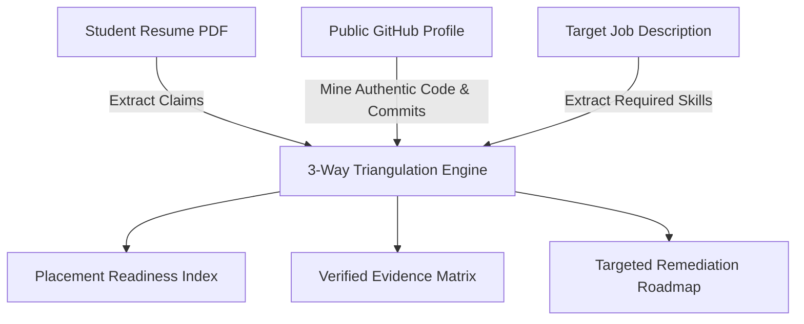
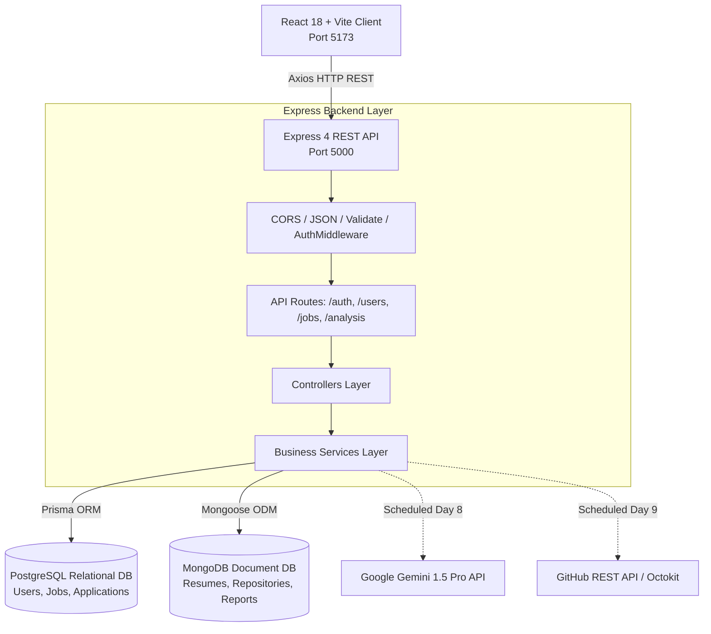

# Tekmira AI — Complete Master Architecture & Development Notes
**Project:** Tekmira AI  
**Tagline:** Beyond Claims. Driven by Evidence.  
**Scope:** Chronological Master Walkthrough (Week 1: Days 1 through 7 Completed) + Architectural Deep Dive & Viva Defense

---

## Table of Contents
1. [Executive Summary & Problem Statement](#1-executive-summary--problem-statement)
2. [The Rebranding & Core Identity](#2-the-rebranding--core-identity)
3. [Day 1: Project Scaffolding, Architecture & Documentation Baseline](#3-day-1-project-scaffolding-architecture--documentation-baseline)
4. [Day 2: Frontend Design System, Shell & Navigation](#4-day-2-frontend-design-system-shell--navigation)
5. [Day 3: JavaScript Core Foundations, Safe API Client & Error Handling](#5-day-3-javascript-core-foundations-safe-api-client--error-handling)
6. [Day 4: PostgreSQL Relational Database, Prisma ORM & SQL JOINs](#6-day-4-postgresql-relational-database-prisma-orm--sql-joins)
7. [Day 5: MongoDB Document Database Foundation & Mongoose Schemas](#7-day-5-mongodb-document-database-foundation--mongoose-schemas)
8. [Day 6: Authentication & Middleware Foundation (Bcrypt + JWT)](#8-day-6-authentication--middleware-foundation-bcrypt--jwt)
9. [Day 7: REST API Architecture, Zod Validation & Full-Stack Integration](#9-day-7-rest-api-architecture-zod-validation--full-stack-integration)
10. [Week 2 Detailed Roadmap: AI & Evidence Extraction Engine (Days 8–14)](#10-week-2-detailed-roadmap-ai--evidence-extraction-engine-days-814)
11. [Week 3 Detailed Roadmap: Quality, Security & Release Engineering (Days 15–21)](#11-week-3-detailed-roadmap-quality-security--release-engineering-days-1521)
12. [Comprehensive System Architecture & Data Flow Diagrams](#12-comprehensive-system-architecture--data-flow-diagrams)
13. [Master Viva Voce & Technical Defense Cheat Sheet](#13-master-viva-voce--technical-defense-cheat-sheet)

---

## 1. Executive Summary & Problem Statement

### 1.1 The Campus Placement Problem
In technical campus placements, college graduates submit resumes claiming proficiencies in advanced frameworks, distributed databases, and high-concurrency architectures (e.g. Docker, Redis, Kubernetes, React, GraphQL). However, recruiters encounter massive **resume inflation**:
- Candidates memorize buzzwords without writing real code.
- Traditional resume screening tools (ATS) only match keywords, penalizing genuine coders whose resumes lack marketing buzzwords.
- Students receive zero actionable, objective feedback on whether their real code matches hiring standards.

### 1.2 The Tekmira AI Solution: 3-Way Triangulation
Tekmira AI solves this by cross-verifying three independent sources of truth:
1. **Claimed Skills (Input):** Extracted from student resume PDFs via natural language parsing.
2. **Empirical Evidence (Proof):** Mined directly from the student's public GitHub repositories (authentic commits, AST language distribution, lines of code, test files).
3. **Objective Benchmarks (Standard):** Ingested from real campus job descriptions (JDs).



---

## 2. The Rebranding & Core Identity

- **Previous Temporary Name:** SkillProof AI
- **Official Identity:** **Tekmira AI**
- **Tagline:** *Beyond Claims. Driven by Evidence.*
- **Workspace Status:** 100% rebranded. Zero occurrences of the old name remain across all frontend components, backend controllers, configuration files, package manifests, and documentation.
- **Color System:**
  - Primary Navy: `#10223D` (Authoritative, structured)
  - Surface Navy: `#203753` (Sidebar, elevated cards)
  - Canvas White: `#FFFFFF` and `#F7F9FC` (~90% of surfaces)
  - Restrained Coral Accent: `#FF806F` (~10% for focal actions and highlights)
  - Typography: `#172033` (High-contrast text), `#64748B` (Muted captions)

---

## 3. Day 1: Project Scaffolding, Architecture & Documentation Baseline

### 3.1 Initial Setup & Scaffolding
- **Client:** React 18, Vite 6, Tailwind CSS 3, React Router v6.
- **Server:** Node.js (v22), Express 4 (pure ES Modules with `"type": "module"`).
- **Decoupled Architecture:** Client and Server are completely separated.
  - Client compiles into static assets deployable to edge CDNs.
  - Server operates as a stateless RESTful API engine.

### 3.2 The Critical `app.js` vs `server.js` Separation
- **`server/src/app.js`:** Configures Express, CORS, JSON body parsers, routes, and centralized error handling middleware. It exports `app` without calling `.listen()`, enabling in-memory automated testing (Supertest) without port collisions.
- **`server/src/server.js`:** The process entry point. It imports `app.js`, binds to `PORT=5000`, and attaches operating system signal listeners (`SIGTERM`, `SIGINT`) for graceful shutdown.

### 3.3 Documentation Baseline Created
On Day 1, five living architectural specifications were created:
1. `PROJECT_RULES.md`: 12 Master Development Rules, zero-secrets policy, and academic 7-Question framework.
2. `docs/PRD.md`: Problem definition, user personas, functional and non-functional requirements.
3. `docs/HLD.md`: System topology, polyglot persistence architecture, network boundaries, and security design.
4. `docs/LLD.md`: Folder structures, component contracts, API endpoint catalogs, and data models.
5. `docs/VIVA_PREP.md`: Living academic question bank for viva voce and project defense.

---

## 4. Day 2: Frontend Design System, Shell & Navigation

### 4.1 Resolution of Initial UI Scaffolding Cards
During early testing, the dashboard temporarily showed cards labeled *"Architecture Readiness Check"*, *"Viva Preparation Tip"*, and *"System Pipeline"*. These placeholders were completely replaced with a student-facing placement portal, and technical notes were relocated to [LLD.md](file:///docs/LLD.md) and [VIVA_PREP.md](file:///docs/VIVA_PREP.md).

### 4.2 Reusable Atomic UI Library (`client/src/components/common/`)
- `Button.jsx`: Variants (`primary`, `secondary`, `outline`, `ghost`, `coral`), loading spinner, accessible focus ring.
- `Card.jsx`: Compound component (`Card`, `CardHeader`, `CardTitle`, `CardDescription`, `CardContent`, `CardFooter`).
- `Input.jsx`: Controlled form input with label association, helper text, error text, and icon slots.
- `Badge.jsx`: Semantic status indicators (`neutral`, `success`, `warning`, `coral`, `navy`).
- `PageHeader.jsx`: Title, subtitle, and action button slots.
- `LoadingIndicator.jsx`: ARIA-compliant loading spinner.
- `ErrorMessage.jsx`: Alert container with retry button callback.
- `EmptyState.jsx`: Zero-data state guiding candidates to connect GitHub or upload a resume.

### 4.3 Shell & Navigation Architecture
- **`MainLayout.jsx`:** Master shell coordinating responsive top Navbar, collapsible mobile Sidebar drawer, and Footer.
- **`Sidebar.jsx`:** Persistent navigation with 8 routes (Overview, Resume Analysis, GitHub Analysis, Job Matching, Skill Evidence, Interview Preparation, Reports, Settings).
- **`Navbar.jsx`:** Top brand navigation with live backend status badge and candidate profile menu dropdown.

---

## 5. Day 3: JavaScript Core Foundations, Safe API Client & Error Handling

### 5.1 JavaScript Foundations Documented in Viva Prep
Detailed explanations, code snippets, Tekmira AI use cases, viva questions, and practice exercises were documented for:
1. **Hoisting:** Difference between `var` (initialized to `undefined`) and `let`/`const` (Temporal Dead Zone).
2. **Closures:** Lexical scoping, private variables, and practical use in debounced search and token management.
3. **Event Loop:** Call Stack $\to$ Web APIs $\to$ Microtask Queue (Promises, `async/await`) $\to$ Macrotask Queue (`setTimeout`, I/O).
4. **Promises vs Callbacks:** Inversion of control, callback hell, Promise states (`pending`, `fulfilled`, `rejected`).
5. **Async/Await & Concurrency:** Synchronous syntax over Promises, `Promise.all` for parallel operations vs `Promise.allSettled`.

### 5.2 Sanitized Error Normalization (`client/src/utils/apiError.js`)
Enforces enterprise security standards by categorizing errors into structured types without leaking internal server information:
- **`NETWORK_ERROR`:** Handles server offline, DNS failures, or CORS blocks with user-friendly guidance.
- **`TIMEOUT_ERROR`:** Informs user when the server took too long to respond.
- **`VALIDATION_ERROR` (400):** Extracts field-level validation errors.
- **`UNAUTHORIZED` (401):** Prompts candidate to sign in.
- **`FORBIDDEN` (403):** Access denied.
- **`NOT_FOUND` (404):** Resource missing.
- **`SERVER_ERROR` (500):** **Critical security protection:** Replaces database connection strings, passwords, or stack traces with: *"An internal server error occurred. Our engineering team has been notified."*
- **`REQUEST_CANCELLED`:** Handled cleanly when an `AbortController` terminates an in-flight request.

### 5.3 Lifecycle Unmount Safety (`AbortController`)
In both `BackendStatusBadge.jsx` and `DashboardPage.jsx`:
- An `AbortController` cancels pending HTTP requests when components unmount or when the user triggers rapid retries.
- Prevents memory leaks and React state updates on unmounted DOM trees.

---

## 6. Day 4: PostgreSQL Relational Database, Prisma ORM & SQL JOINs

### 6.1 Polyglot Persistence Architecture
Tekmira AI separates structured relational data from semi-structured document data:
- **PostgreSQL (Relational):** Strict ACID transactions, foreign key constraints, relational queries (Users, Job Descriptions, Saved Jobs, Job Applications).
- **MongoDB (Document-Oriented):** Polymorphic AST trees, raw resume texts, repository commit trees, and full AI report JSON payloads.

### 6.2 Prisma Relational Schema (`server/prisma/schema.prisma`)
- `User` (UUID, email, passwordHash, role, timestamps).
- `JobDescription` (title, company, requiredSkills array, minExperience).
- `SavedJob` (composite unique `@@unique([userId, jobId])` with `onDelete: Cascade`).
- `JobApplication` (application status enum, matchScore, appliedAt, notes).

### 6.3 Relational Service Layer & SQL JOIN Equivalents
Created [`server/src/services/jobApplicationService.js`](file:///server/src/services/jobApplicationService.js) demonstrating:
- `INNER JOIN` between candidate applications and job descriptions.
- `LEFT OUTER JOIN ... WHERE IS NULL` to identify inactive candidates.
- `GROUP BY` aggregation calculating placement readiness metrics across jobs.

---

## 7. Day 5: MongoDB Document Database Foundation & Mongoose Schemas

### 7.1 Mongoose Schemas (`server/src/models/`)
- **`ResumeDocument`:** Stores parsed candidate resume text and embedded claims (`skills`, `projects`, `education`).
- **`RepositorySnapshot`:** Stores mined GitHub repositories with embedded `languages` and `authenticCommits` (verifying authored commits, additions, deletions).
- **`SkillAnalysisReport`:** Stores complete 3-way triangulation evaluations between resume claims, GitHub proof, and job requirements with `verificationStatus` enum (`VERIFIED`, `INFLATED_CLAIM`, `UNCLAIMED_STRENGTH`, `MISSING_CRITICAL`).

### 7.2 Document CRUD Services
- [`ResumeService.js`](file:///server/src/services/resumeService.js): Create, Read, Update claims, and Delete resume documents with candidate ownership verification.
- [`RepositoryService.js`](file:///server/src/services/repositoryService.js): Upsert and retrieve mined GitHub repository snapshots.
- [`AnalysisReportService.js`](file:///server/src/services/analysisReportService.js): Create, populate, and query explainable skill triangulation reports.

---

## 8. Day 6: Authentication & Middleware Foundation (Bcrypt + JWT)

### 8.1 Password Hashing with Bcrypt
- Hashes plaintext passwords using `bcryptjs` with 10 salt rounds.
- Rejects passwords under 8 characters.
- Strips password digests using `AuthService.sanitizeUser()`.

### 8.2 Stateless JWT Lifecycle & Auth Middleware
- Signs 128-bit HS256 tokens configured via `JWT_SECRET` and `JWT_EXPIRES_IN=7d`.
- **`authenticate` middleware:** Validates incoming `Authorization: Bearer <token>` headers, verifies signature, and attaches safe `req.user`. Missing, malformed, or expired tokens return HTTP 401.
- **`authorizeRoles(...roles)`:** Role-Based Access Control (RBAC) middleware verifying candidate permissions.
- Operational endpoints: `POST /api/auth/register`, `POST /api/auth/login`, `GET /api/users/me`.

---

## 9. Day 7: REST API Architecture, Zod Validation & Full-Stack Integration

### 9.1 Runtime Request Validation with Zod
- Implemented reusable validation middleware ([`server/src/middleware/validate.js`](file:///server/src/middleware/validate.js)).
- Validates request body, query, and params against Zod schemas ([`authValidation.js`](file:///server/src/validations/authValidation.js), [`analysisValidation.js`](file:///server/src/validations/analysisValidation.js)).
- On validation failure, extracts field paths and issues standardized HTTP 400 Bad Request with field-level error arrays.

### 9.2 Centralized Error Handling & Safe Logging
- Centralized error middleware ([`server/src/middleware/errorHandler.js`](file:///server/src/middleware/errorHandler.js)) translates Prisma `P2002` duplicate errors into HTTP 409 Conflict, Mongoose `CastError` into HTTP 400, and sanitizes 500 server errors in production.

### 9.3 Full-Stack Frontend Integration
- **`LoginPage.jsx`:** Connected to `POST /api/auth/login` with loading indicators, error banners, and redirect to `/dashboard`.
- **`RegisterPage.jsx`:** Connected to `POST /api/auth/register` with field-level validation feedback.
- **`JobMatchPage.jsx`:** Connected to `GET /api/jobs` fetching benchmark campus roles from PostgreSQL with AbortController lifecycle cleanup.

---

## 10. Week 2 Detailed Roadmap: AI & Evidence Extraction Engine (Days 8–14)

With the foundational full-stack architecture (React, Express, PostgreSQL, MongoDB, JWT Auth, and REST APIs) 100% complete and verified, Week 2 shifts into the **AI & Evidence Extraction Engine**:

### Day 8: Gemini API Integration
- **Target:** Integrate Gemini securely through the Express backend and build the first AI service.
- **Concepts:** LLM API integration, environment variables, async/await, third-party API error handling.
- **Prompt 8.1 – Teach LLM and Gemini fundamentals:** Model architectures, API tokens, temperature/top-p, prompt-response lifecycle, latency, token costs, and failure modes.
- **Prompt 8.2 – Integrate Gemini backend service:** Install `@google/genai` official SDK, load `GEMINI_API_KEY` from server environment variables, build singleton Gemini client, and create `POST /api/ai/analyze-resume` endpoint.
- **Prompt 8.3 – Connect AI endpoint to frontend:** Build candidate UI workflow that sends resume text or clearly marked development sample to the backend and renders AI feedback with loading, retry, and error states.
- **Prompt 8.4 – Test and document Gemini integration:** Automated unit tests with mocked Gemini responses covering missing API keys, rate limits (HTTP 429), timeouts, and malformed outputs.
- **End-of-Day Quality Gate:** Zero exposed API keys, mocked test suite passing, end-to-end backend-to-frontend text analysis verified.

### Day 9: Prompt Engineering & Structured Outputs
- **Target:** Create reliable prompts and schema-validated JSON outputs for analysis.
- **Concepts:** System instructions, prompt engineering, structured outputs (`responseSchema`), input validation, LLM hallucination suppression.
- **Prompt 9.1 – Teach prompt engineering:** System vs user prompts, few-shot examples, negative constraints, hallucination reduction, and prompt quality evaluation.
- **Prompt 9.2 – Create reusable prompt templates:** Standardized prompt templates for resume skill extraction, repository evidence interpretation, job requirement extraction, and gap analysis.
- **Prompt 9.3 – Implement structured JSON output:** Configure Gemini `responseSchema` or server-side Zod validation for extracted skills, confidence ratings, and evidence citations.
- **Prompt 9.4 – Test prompt and schema quality:** Edge cases including sparse resumes, conflicting claims, adversarial prompt injection text, and malformed model outputs.
- **End-of-Day Quality Gate:** 100% schema validation pass rate, zero hallucinated evidence allowed, prompt injection safely treated as untrusted text.

### Day 10: Resume Upload & PDF Text Extraction
- **Target:** Build secure PDF upload, text extraction, and MongoDB persistence.
- **Concepts:** Multipart/form-data, Multer streaming, MIME type validation, magic byte file signatures, PDF stream parsing (`pdf-parse`), MongoDB CRUD.
- **Prompt 10.1 – Teach file upload and PDF extraction:** Binary streams, file signatures (`%PDF`), buffer handling, and security risks of arbitrary file execution.
- **Prompt 10.2 – Implement secure resume upload:** Multer middleware with 5MB size limit, MIME type whitelist (`application/pdf`), sanitized filename generation, and temporary storage cleanup.
- **Prompt 10.3 – Extract and persist resume data:** Extract plain text from PDF stream, store structured metadata in MongoDB `ResumeDocument`, and associate with authenticated candidate.
- **Prompt 10.4 – Test upload cases:** Test suite for valid PDF, invalid extension, wrong MIME, corrupt header, oversized file, and empty PDF.
- **End-of-Day Quality Gate:** Multi-page PDF text extraction verified, MongoDB resume records linked to candidate, error boundaries active for unreadable/scanned PDFs.

### Day 11: GitHub REST API Integration
- **Target:** Retrieve public repository metadata and source evidence safely.
- **Concepts:** GitHub REST API v3, Octokit, URL parsing, tree walking, rate limit caching, untrusted code handling.
- **Prompt 11.1 – Teach GitHub API and repository evidence:** Owner/repo identifiers, Git tree objects, pagination, API rate limits (60/hr unauthenticated vs 5000/hr authenticated).
- **Prompt 11.2 – Implement public repository validation:** Sanitize candidate-submitted GitHub URLs, parse owner/repo slugs safely, and check existence via GitHub API.
- **Prompt 11.3 – Retrieve repository evidence:** Fetch repo metadata, languages breakdown, directory trees, and targeted file contents (`package.json`, source files). Store snapshot in MongoDB `RepositorySnapshot`.
- **Prompt 11.4 – Handle API limits and test:** Implement rate limit headers inspection, caching layer, and automated tests with mocked GitHub responses.
- **End-of-Day Quality Gate:** Repository snapshots persisted with authentic commit authors, zero arbitrary code execution, rate limits handled gracefully.

### Day 12: Skill Evidence Matching Engine
- **Target:** Compare resume claims, repository evidence, and job requirements using explainable logic.
- **Concepts:** 3-Way Triangulation algorithm, deterministic skill normalization, explainable scoring formula, Gemini contextual interpretation, report persistence.
- **Prompt 12.1 – Model the skill verification problem:** Define entities and mathematical formula for Claimed vs Demonstrated vs Required skills.
- **Prompt 12.2 – Build deterministic skill matching:** Exact and alias matching, category grouping, AST-to-claim mapping, and evidence line citation (e.g. `express` in `package.json`).
- **Prompt 12.3 – Add AI contextual interpretation:** Use Gemini to interpret ambiguous implementation patterns, evaluate architectural depth, and generate explanatory rationales.
- **Prompt 12.4 – Generate and persist reports:** Synthesize findings into `SkillAnalysisReport` document in MongoDB with overall readiness score, verified competencies, and missing gaps.
- **End-of-Day Quality Gate:** Deterministic scoring logic verified with 0% randomness in mathematical scores, reports linked to both candidate and repository snapshot.

### Day 13: Analysis Dashboard Integration
- **Target:** Display real analysis data in reusable React dashboard components.
- **Concepts:** React component composition, asynchronous data fetching, loading skeletons, empty states, error boundaries, responsive charts.
- **Prompt 13.1 – Connect real report APIs:** Wire candidate dashboard to `GET /api/analysis/:id` using centralized `apiClient`. Show clear empty state when no report exists.
- **Prompt 13.2 – Build analysis dashboard sections:** Render Placement Readiness Index meter, Claimed Skills list, Verified Evidence matrix, and Missing Skill gaps.
- **Prompt 13.3 – Add robust UI states:** Implement smooth transitions between loading indicator, error alert with retry button, empty state, and completed report.
- **Prompt 13.4 – Verify dashboard integration:** Full-stack integration tests verifying data flows from MongoDB through Express REST controllers into React state.
- **End-of-Day Quality Gate:** Responsive UI tested across mobile, tablet, and desktop; zero hardcoded fake scores; interactive clickable evidence links.

### Day 14: AI Interview Preparation
- **Target:** Generate project-grounded viva questions and evaluate student answers cautiously.
- **Concepts:** Grounded viva question generation, multi-difficulty rubrics, candidate answer evaluation, session tracking in MongoDB.
- **Prompt 14.1 – Design interview preparation flow:** Define viva simulation architecture grounded strictly in the candidate's verified GitHub code.
- **Prompt 14.2 – Implement question generation:** Express endpoint `POST /api/ai/interview/generate` calling Gemini with repo context to produce targeted questions.
- **Prompt 14.3 – Implement answer evaluation:** Endpoint `POST /api/ai/interview/evaluate` comparing candidate explanations against technical rubrics.
- **Prompt 14.4 – Build interview UI and tests:** Interactive Q&A interface with timer, answer submission box, scoring feedback, and historical performance tracking.
- **End-of-Day Quality Gate:** Viva questions reference candidate's real files, evaluation is objective and constructive, session history saved in MongoDB.

---

## 11. Week 3 Detailed Roadmap: Quality, Security & Release Engineering (Days 15–21)

Week 3 delivers enterprise hardening, comprehensive automated testing, containerization, production deployment, and project assessor defense preparation:

### Day 15: Controlled Forms & Validation Boundary
- **Target:** Make resume, GitHub, and job-description forms robust and accessible.
- **Concepts:** Controlled inputs, form validation, client UX + server Zod validation boundary, async/await submission handling.
- **Prompt 15.1 – Audit forms:** Review all user input surfaces (registration, login, resume upload, repo URL input, job description input).
- **Prompt 15.2 – Implement controlled inputs:** Use React state for controlled inputs, accessible labels (`aria-*`), disabled loading states, and double-submit prevention.
- **Prompt 15.3 – Add client and server validation:** Instant inline client feedback for fast UX, coupled with strict server-side Zod schemas as the non-bypassable security boundary.
- **Prompt 15.4 – Test form edge cases:** Automated tests for empty strings, whitespace trimming, invalid URL protocols, SQL/script injection attempts, and network errors.
- **End-of-Day Quality Gate:** Zero unhandled form errors, keyboard-accessible navigation, server rejects all invalid payloads.

### Day 16: Automated API & Unit Testing
- **Target:** Add meaningful unit and integration tests for critical application flows.
- **Concepts:** Unit testing, integration testing, Supertest, test fixtures, test isolation, mock external services.
- **Prompt 16.1 – Teach testing strategy:** Pyramid of testing (Unit vs Integration vs E2E), mocking principles, and why third-party LLM and GitHub APIs must be mocked in CI/CD.
- **Prompt 16.2 – Configure test tooling:** Setup Jest/Vitest and Supertest in `server/`, separate test environment configuration (`.env.test`), and in-memory test databases.
- **Prompt 16.3 – Write unit tests:** Unit tests for skill normalization algorithms, placement readiness score calculations, Zod schemas, and prompt formatters.
- **Prompt 16.4 – Write API integration tests:** Automated endpoint tests covering health check, registration, login, token refresh, protected resource access, and 404/500 error handlers.
- **End-of-Day Quality Gate:** Test suite executes with 100% pass rate, zero real API calls made during test execution, comprehensive test report generated.

### Day 17: Docker Containerization
- **Target:** Containerize the application and its databases for reproducible local development and deployment.
- **Concepts:** Docker, multi-stage Dockerfiles, Docker Compose, bridge networking, persistent named volumes, health checks.
- **Prompt 17.1 – Teach Docker fundamentals:** Images vs containers, container layers, cache optimization, network isolation, and database volume persistence.
- **Prompt 17.2 – Create Docker configuration:** Multi-stage `Dockerfile` for React client (Nginx alpine runtime) and Express server (Node.js alpine), plus root `docker-compose.yml`.
- **Prompt 17.3 – Configure container environments:** Safe `.env.example` with container service hostnames (`postgres`, `mongo`) replacing `localhost`.
- **Prompt 17.4 – Run and verify containers:** Start full multi-container stack (`docker compose up --build`), verify database volume persistence across restarts, and run health check probes.
- **End-of-Day Quality Gate:** Complete stack spins up with a single command, database data persists across container destruction, health checks green.

### Day 18: MongoDB Aggregation & Query Optimization
- **Target:** Add meaningful aggregation reports and improve query patterns where justified.
- **Concepts:** MongoDB aggregation pipelines (`$match`, `$group`, `$project`, `$sort`, `$unwind`), indexing strategies, performance profiling (`explain()`).
- **Prompt 18.1 – Teach aggregation pipelines:** Pipeline stages, document transformation, memory limits, and index utilization in pipeline queries.
- **Prompt 18.2 – Implement useful aggregations:** Campus cohort skill distribution, average readiness index by graduation year, most frequent missing skills, and candidate analysis trends.
- **Prompt 18.3 – Review query performance:** Inspect query execution plans with `explain("executionStats")`, add compound indexes on high-cardinality fields (`candidateId + createdAt`).
- **Prompt 18.4 – Test aggregation outputs:** Fixture-based tests verifying pipeline math across empty collections, single users, and multi-candidate datasets.
- **End-of-Day Quality Gate:** Aggregation queries execute in <50ms, compound indexes documented and verified, zero in-memory document grouping bottlenecks.

### Day 19: Production Deployment
- **Target:** Prepare and deploy frontend, backend, and managed databases safely.
- **Concepts:** Production cloud deployment, Vercel/Netlify for client, Render/Railway for Express, Neon for PostgreSQL, MongoDB Atlas for MongoDB.
- **Prompt 19.1 – Prepare deployment plan:** Select cost-free/student-tier managed cloud providers with automated branch deployment hooks.
- **Prompt 19.2 – Prepare production configuration:** Configure production build scripts, strict CORS allowlist for production client domain, secure HTTPS cookies, and environment variable documentation.
- **Prompt 19.3 – Deploy backend and databases:** Provision managed PostgreSQL on Neon, MongoDB cluster on Atlas, and deploy Express REST API to cloud runtime.
- **Prompt 19.4 – Deploy frontend and smoke test:** Deploy React production build to Vercel/Netlify, set `VITE_API_URL`, and execute live smoke test across registration, login, and analysis flows.
- **End-of-Day Quality Gate:** Live HTTPS URLs documented, production health check responding with HTTP 200, zero development secrets exposed.

### Day 20: Security, Reliability & Responsive Audit
- **Target:** Audit user data isolation, untrusted content handling, and application quality.
- **Concepts:** OWASP Top 10, threat modeling, prompt injection mitigation, role-based access control, responsive layout audit.
- **Prompt 20.1 – Perform threat modeling:** Document threat vectors: credential stuffing, JWT tampering, unauthorized document access, API key leakage, and denial of service.
- **Prompt 20.2 – Defend against untrusted content and prompt injection:** Strict separation of system prompts from untrusted resume and repo text; enforce input sanitization and length caps.
- **Prompt 20.3 – Audit API and data access:** Server-side ownership checks on all endpoints (`req.user.id === resource.userId`), rate limiting with `express-rate-limit`, and safe error masking.
- **Prompt 20.4 – Audit frontend quality:** Mobile viewport responsiveness test (320px to 4K), screen reader accessibility check, focus rings, and console error eradication.
- **End-of-Day Quality Gate:** Threat model documented in `docs/SECURITY.md`, prompt injection defenses verified by automated tests, responsive layout certified.

### Day 21: Documentation, Concept Evidence & Viva Readiness
- **Target:** Prepare the public repository and evidence map for Project Assessor evaluation.
- **Concepts:** Concept evidence mapping, documentation consistency, Git workflow, project explanation.
- **Prompt 21.1 – Audit repository against actual implementation:** Codebase inspection verifying every documented claim in PRD/HLD/LLD matches real source code. Eliminate dead code and fake mocks.
- **Prompt 21.2 – Update required documentation:** Synchronize `README.md`, `docs/PRD.md`, `docs/HLD.md`, and `docs/LLD.md` with accurate architecture diagrams and API route tables.
- **Prompt 21.3 – Create concept evidence map:** Author `docs/CONCEPT_EVIDENCE.md` listing every curriculum concept, its source file path, line numbers, and demonstration steps.
- **Prompt 21.4 – Prepare viva practice:** Conduct comprehensive viva practice covering full-stack concepts, database trade-offs, security defenses, and AI prompt engineering.
- **Prompt 21.5 – Final release verification:** Execute clean production build, run all automated test suites, scan for accidental secrets with `git-secrets`, and push final release tag to GitHub `main`.
- **End-of-Day Quality Gate:** 100% test pass rate, comprehensive `CONCEPT_EVIDENCE.md` complete, clean Git log, repository ready for Project Assessor grading.

---

## 12. Comprehensive System Architecture & Data Flow Diagrams

### 12.1 Full-Stack Topology


### 12.2 Request-Response Lifecycle & Middleware Order
```
Client Request
      |
      v
[ cors() ] -> Handles origin whitelist & preflight OPTIONS
      |
      v
[ express.json() ] -> Parses JSON payload into req.body
      |
      v
[ validate(schema) ] -> Zod runtime schema check (halts with 400 on error)
      |
      v
[ authenticate ] -> Verifies Bearer token, decodes JWT, attaches req.user (halts with 401 on error)
      |
      v
[ authorizeRoles ] -> Checks candidate permissions (halts with 403 on error)
      |
      v
[ Route Controller ] -> Calls Service -> Queries PostgreSQL / MongoDB
      |
      v
[ Centralized Error Handler ] -> Catches any unhandled errors, strips stack trace, sends standard JSON
      |
      v
Client Receives Standardized { success, message, data }
```

---

## 13. Master Viva Voce & Technical Defense Cheat Sheet

| Question | Examiner's Focus | Key Technical Answer |
| :--- | :--- | :--- |
| **Why not just evaluate resumes with ChatGPT or Gemini?** | Architecture & Hallucination Prevention | LLMs evaluating only a resume judge *claims*, not *evidence*. This rewards resume inflation and causes hallucination. Tekmira AI grounds evaluation by cross-verifying resume claims against empirical GitHub commit code and objective job requirements. |
| **Why separate `app.js` from `server.js`?** | Separation of Concerns & Automated Testing | `app.js` configures middleware and routes without binding to a physical network port, allowing automated testing libraries (Supertest) to test endpoints in-memory. `server.js` binds to the physical port and manages OS process termination signals. |
| **Why use UUIDs instead of auto-incrementing integers?** | Database Security & Privacy | Sequential IDs (1, 2, 3...) are vulnerable to enumeration attacks where unauthorized users guess other candidate profiles. UUIDv4 provides 128-bit globally unique, unguessable identifiers. |
| **Why use both PostgreSQL and MongoDB (Polyglot Persistence)?** | Data Modeling Fundamentals | Relational data with strict foreign keys and ACID constraints belongs in PostgreSQL (Users, Job Postings, Applications). Polymorphic, deeply nested trees (resume ASTs, commit trees, and AI reports) belong in MongoDB. |
| **What is the Microtask Queue vs Macrotask Queue in the Event Loop?** | JavaScript Runtime Internals | The Microtask Queue (Promise callbacks, `await` continuations) has higher priority. The Event Loop exhausts all pending microtasks immediately after the Call Stack empties and before executing the next Macrotask (`setTimeout`, I/O). |
| **How does Prisma ORM prevent SQL Injection?** | Web Application Security | Prisma automatically converts all queries into **parameterized queries** (`$1`, `$2`), treating user inputs strictly as literal data rather than executable SQL syntax. |
| **Why use `bcrypt` salts and work factors?** | Cryptographic Security | The salt ensures identical passwords produce distinct hashes, neutralizing precomputed Rainbow Table attacks. The configurable work factor (10 rounds) makes brute-force cracking computationally prohibitive. |
| **Why should RESTful endpoints use nouns instead of verbs?** | REST Constraints | In REST, URIs represent resources (nouns like `/jobs`), while HTTP verbs (`GET`, `POST`, `PUT`, `DELETE`) communicate the operation. Using verbs in URIs violates the Uniform Interface constraint. |
| **Why validate request payloads at runtime with Zod?** | Defensive API Design | TypeScript or JavaScript type assertions only exist at compile time; runtime attacks, malformed JSON, and unexpected nulls occur in production. Zod validates boundaries before inputs reach database queries. |

---

## 14. Week 2 (Days 8–14) Core Engine & AI Gateway
- **Day 8 (Gemini 2.5 Flash API Gateway):** Official `@google/genai` SDK architecture, fail-safe fallback mock, system prompt isolation.
- **Day 9 (Prompt Engineering & Zero-Hallucination):** Native OpenAPI decoding sampler schemas (`responseSchema`) and Zod runtime invariants.
- **Day 10 (PDF Resume Ingestion & Parsing):** Multer in-memory buffers, `%PDF-` magic byte inspection, SHA-256 deduplication, scanned document detection.
- **Day 11 (GitHub REST API Evidence Mining):** Recursive tree traversal (`GET /git/trees/...`), language distribution calculation, AST dependency extraction (`package.json`, `pom.xml`, `requirements.txt`), commit author verification.
- **Day 12 (3-Way Triangulation & Placement Readiness Index):** Empirical matrix classification (`VERIFIED`, `INFLATED_CLAIM`, `UNCLAIMED_STRENGTH`, `MISSING_CRITICAL`), mathematical PRI formula ($0$–$100$), remediation action planner.
- **Day 13 (Analysis Dashboard Integration):** Real-time async state, radial SVG PRI meter, 4 metric cards, 3-way filterable skills breakdown, `AbortController` cleanup guards.
- **Day 14 (AI Technical Viva Voce & Grounded Defense):** Codebase-grounded question generator citing real repo files, 3-part academic rubric (Accuracy 40%, Evidence 35%, Clarity 25%), cumulative score tracking, ethical AI disclaimer.
- **Master Notes Documentation:** Complete 20+ page master reference compiled in [`docs/Tekmira_AI_Week_2_Master_Notes.html`](file:///c:/Users/phani/OneDrive/Desktop/Tekmira AI/docs/Tekmira_AI_Week_2_Master_Notes.html).

---

## 15. Day 15 — Controlled Forms & Client-Server Validation Boundary
- **Controlled Inputs:** React state management across candidate registration, login, resume upload, GitHub mining URL, benchmark job selection, and viva answer submission.
- **Client Validation Utilities (`clientValidation.js`):** Synchronous format and boundary checks (`validateEmail`, `validatePassword`, `validateFullName`, `validateGitHubUrl`, `validateCustomJobDescription`, `validateVivaAnswer`).
- **Accessible Error States:** Inline `aria-invalid`, `aria-describedby`, error alert styling (`border-coral-500`), and live character counters with threshold warnings.
- **Accidental Duplicate Submission Prevention:** Submission refs (`isSubmittingRef`) and disabled/loading button states preventing race conditions and double network dispatches.
- **Server-Side Zod Boundaries:**
  - `fetchRepositoryEvidenceSchema` added to `POST /api/analysis/repositories/fetch`.
  - `triangulateSkillsSchema` added to `POST /api/analysis/triangulate`.
  - `createInterviewSessionSchema` added to `POST /api/interview/sessions`.
  - `evaluateAnswerSchema` added to `POST /api/interview/sessions/:id/evaluate`.
- **Automated Verification:** 27 test cases in `server/src/test/testFormValidationEdgeCases.js` covering empty payloads, whitespace bypasses, invalid URLs, excessive lengths, and malformed inputs (**27 passed, 0 failed**).
- **Master Test Suite:** **275 / 275 tests passing across all 11 suites**. Production client build verified passing (`vite build` in 4.45s, 0 errors).
